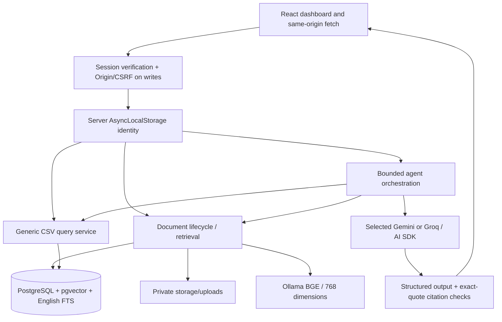
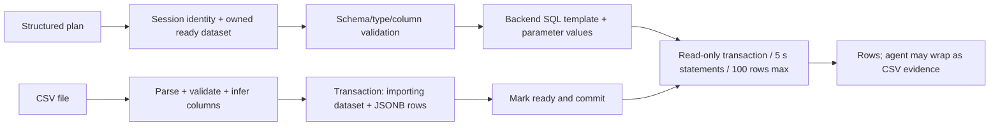
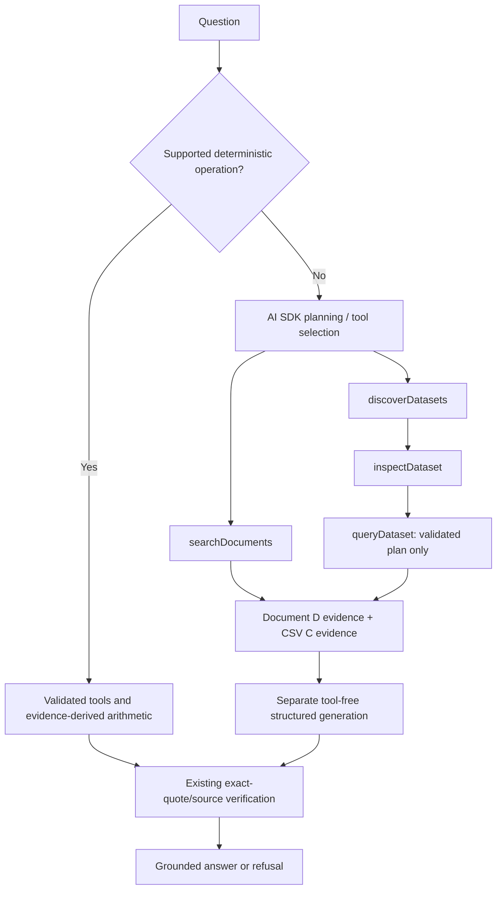

# Current architecture

This guide describes the implemented architecture; Day 10 adds generic CSV lifecycle operations documented in the [CSV lifecycle guide](day-10-csv-lifecycle.md). Historical day reports preserve earlier designs; current code is authoritative.

## Components and trust boundaries



- Root `app/` contains pages and API route handlers. `app/components/` contains auth, dashboard shell, document manager, dataset explorer and chat components. Tailwind 4 is processed through PostCSS and imported by the root layout.
- `src/lib/auth-client.ts` manages session refresh and the separate CSRF token. The browser owns the HttpOnly session cookie. Protected dashboard navigation is a client session gate; actual data authorization is enforced on every backend API call.
- `src/lib/auth.ts` checks the database session, exact Origin and session-bound CSRF token for mutations. `identity.ts` exposes the verified owner to services. Client `userId` values are never authorization inputs.
- `db.ts` supplies the PostgreSQL pool and query timing. Services keep owner and ready-status filters before evidence is sent to a provider. Application query filters implement tenant isolation; this is not a claim that PostgreSQL RLS policies exist.
- `ai-provider.ts` selects one provider explicitly. `provider-transport.ts` implements process-local pacing, bounded 429 retry and request-aware deadlines. There is no fallback to the other provider.
- Safe diagnostics record request IDs, stage/tool names, outcome, duration and allowlisted error classes. They intentionally omit prompts, evidence, credentials, raw provider bodies and arbitrary stacks.

## Document upload and lifecycle

```mermaid
sequenceDiagram
  participant B as Browser
  participant API as Authenticated upload API
  participant PG as PostgreSQL
  participant O as Ollama
  participant F as Private files
  B->>API: Multipart file + cookie + CSRF; browser Origin
  API->>PG: Owner transaction/advisory lock + SHA-256 duplicate check
  API->>API: Parse PDF/DOCX; chunk original text
  loop Each chunk
    API->>O: Existing BGE embedding
  end
  API->>F: Save UUID-named private file
  API->>PG: Insert processing document/chunks
  opt Explicit replacement
    API->>PG: Supersede previous version; remove old chunks; queue cleanup
  end
  API->>PG: Publish ready + audit event; commit
  API-->>B: Document ID, chunks, version
```

Parsing uses PDFParse or Mammoth raw text. Chunking defaults to approximately 500 **characters**, with 100-character overlap and boundary adjustment. New ingestion currently inserts no page_number, so it is usually null; existing metadata is preserved where present.

A per-owner transaction advisory lock serializes lifecycle changes, and a partial unique `(user_id,file_hash)` index for ready documents protects against concurrent duplicates. Same filename alone never means replacement. Replacement creates a new document ID/version, points to the predecessor and publishes atomically; failed preparation retains the previous active version.

Deletion changes status and removes chunks/embeddings in a transaction before file cleanup. Deleted/superseded versions are excluded from retrieval and active listing even if unlink fails. File cleanup uses backend-owned paths, UUID validation and owner-scoped queued jobs. Tombstones/events are retained; old chunk/file contents are not an archival version store. In-flight requests may already hold retrieved excerpts; deletion does not revoke an already constructed context or saved browser response.

Unpublished file cleanup can fail, and uncertain commits require reconciliation rather than blindly unlinking a possibly published file. There is no scheduled cleanup worker in this repository. See [database lifecycle](database.md) and [deployment notes](deployment.md).

## CSV upload and structured querying



Inference yields number, boolean or text per column; empty cells become null. The whole import commits or rolls back. Filters run **before** aggregation. SUM/AVG require numeric columns, aggregate output is `value`, and sort columns must fit the selected output. No model-provided SQL is executed. Raw CSV files for the generic path are parsed into database rows rather than retained as document files. The legacy employee-leave importer is separate and not discoverable by generic CSV tools.

## Document RAG

`POST /api/chat` validates a strict question-only JSON body, loads the selected provider configuration and retrieves owned ready chunks. Semantic mode uses cosine nearest neighbors. Hybrid mode gets up to 20 semantic and 20 full-text candidates, deduplicates by chunk ID and computes RRF with `k=60`: `1/(60+semanticRank) + 1/(60+keywordRank)` for available branch ranks.

Deterministic sorting uses fused score, strongest branch rank, keyword rank and numeric chunk ID; at most three chunks are returned. English FTS uses OR-connected normalized query terms. Semantic-only candidates need the cosine cutoff; keyword-qualified hybrid hits can survive below it. `selectEvidence` also applies eligibility, caps context to three excerpts and truncates each to 6,000 original characters.

No eligible evidence yields a canonical grounded=false refusal without generation. Otherwise the model returns structured statements with sourceId/quoteId selections from backend-provided quote choices; the backend copies exact original excerpts rather than trusting reconstructed quote text. The server validates shape, source IDs and quote membership and adds `[S1]` markers. It does not prove semantic entailment or completeness.

## Multi-Source Agent



`knowledge-agent.ts` first checks narrow deterministic listing/comparison grammars and the existing role-count shortcut. These use the same authorized tools, schema/SQL validation, evidence and citation verifier without provider calls. They compute explicit differences and render every bounded result row; recognized but unsafe/ambiguous forms abstain. They do not recognize arbitrary prose, columns or policy precedence. See [operation boundaries](agent-remaining-failures-resolution.md).

For other questions, it allows eight planning steps and ten backend tool calls. Dataset discovery and schema inspection are prerequisites to querying. Tool argument validation, owner filtering, SQL safety and result bounds stay in backend-controlled functions. Tool errors can be returned safely to permit a corrected call within the budget.

For combined reasoning, document thresholds must be supported by document evidence and actual values by CSV results. Team-total thresholds require grouped SUM across all relevant rows; row-level threshold filtering is not equivalent. The final model call has no tools and must abstain when evidence is missing, contradictory or insufficient. For the general agent this remains model instruction plus schema/citation enforcement, not deterministic semantic verification. General Groq tool-use failures remain possible. Recognized cross-source conclusions additionally require both evidence families in each statement, with explicit filename binding where supplied; this is necessary provenance coverage, not arbitrary entailment verification. Deterministic supported operations separately validate typed operands, exact decimal differences and complete bounded rendering; they do not prove arbitrary document semantics.

Document citations use D IDs; CSV citations use C IDs with filename, dataset ID, executed plan, rows, serialized text, quotes and possible-truncation flag. Discovery/schema alone cannot become cited evidence. Chat UI conversations remain in component memory and are not persisted; later questions are submitted individually, not as a backend conversation transcript.

## Authentication and isolation

Passwords use salted scrypt (N=131072, r=8, p=1); only hashes are stored. Session tokens are random 32-byte values, with only SHA-256 token hashes stored. Sessions expire after eight hours; logout removes the server session and expires the cookie. Production uses Secure/HttpOnly/SameSite=Strict `__Host-knowledge-session`; development uses `knowledge-session` without Secure for local HTTP.

Login/signup require exact Origin; authenticated mutations additionally require X-CSRF-Token matching the verified session. A CSRF token is returned to JavaScript; the session token is never returned in JSON. Accounts without credentials remain passwordless until explicitly enrolled by the operator, without transferring their data.

Owner filters join chunks to documents and rows to datasets. Foreign IDs receive generic not-found/unavailable results. Files cannot be requested through arbitrary paths. Authentication/authorization precede retrieval or tools; only scoped evidence reaches the provider. Signup exposes duplicate registration through 409, while invalid login remains generic. [Deployment limitations](deployment.md) cover remaining account and operational controls.


## Quota and generic SLA reliability follow-up

[Quota/evidence/SLA implementation](agent-quota-evidence-sla-reliability.md) adds persistent same-host budget coordination, safe usage counts, stable chunk IDs across different searches and compact model-facing views that preserve original server evidence. Supported first-response SLA operations use scoped document rules and validated priority/metric row filters, calculate differences deterministically and retain both citations. Unknown formats, scoped/ambiguous rules and truncated results abstain. Regional-lead joins and arbitrary policy semantics remain outside that deterministic grammar.

## Final implementation note — 30 October 2026

Groq admission uses the persistent same-host ledger for request/token minute/day budgets, pending reservations and reconciliation. Deadline-aware waiting rechecks capacity; it cannot guarantee admission within a request deadline or coordinate independent hosts. See [current operational evidence](submission-final/report.md). Controlled row-level policy predicates can be evaluated against an authorized coherent CSV snapshot, retaining applicable, inapplicable and unknown classifications. Backend-derived qualified counts retain policy provenance and verified document/CSV references; unsupported grammar or conflicts still refuse. Original evidence remains available to citation verification. See [row applicability](evaluation/row-policy-applicability/report.md).
