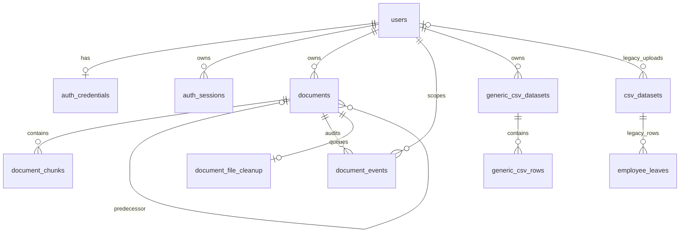

# Database and lifecycle reference

PostgreSQL 18.6 / pgvector 0.8.1 were verified locally. The application uses `pg`; there is no ORM; a guarded fresh-only migration runner is provided. This guide was checked against service SQL, migrations 001–009 and read-only live catalog metadata. Catalog inspection did not expose user rows. Only a separate disposable cluster was migrated for fresh-setup verification; the original database was not changed.

## Fresh setup and migration safety

Initial migrations 001–005 were reconstructed from the existing read-only catalog and service SQL. They create pgvector, users, base documents/chunks (768-dimensional embeddings) and legacy CSV tables. Existing migrations 006–009 are unchanged. All nine were applied successfully to an empty, separate PostgreSQL 18 cluster; the original database was not migrated.

Install the PostgreSQL-compatible pgvector package first. Create an empty database using a migration administrator, then set `FRESH_DATABASE_URL` privately and run:

```bash
npm run db:setup:fresh -- --confirm-empty-database new_database
```

The URL database name must exactly match the confirmation. The command has no fallback to `DATABASE_URL`, rejects that configured database name when supplied, takes an advisory lock and refuses existing application objects or custom schemas. It never resets data. Do not use this command for incremental upgrades. A failure can leave earlier migrations applied; inspect and repair only the new installation, rather than forcing a rerun. No migration-history ledger is provided.

Use a distinct runtime role with CONNECT/TEMP on its database, USAGE on public, SELECT/INSERT/UPDATE/DELETE on application tables and USAGE/SELECT on sequences. Do not grant runtime schema CREATE, superuser, CREATEDB or CREATEROLE. Migration ownership remains with the administrator. Keep connection credentials out of shell history and source control.

`npm run test:fresh-db` creates its own private /tmp cluster using PostgreSQL 18 binaries, disables TCP, installs 001–009, checks schema and least privilege, runs all database-enabled tests with fictional fixtures, and removes only that cluster. It needs local PostgreSQL binaries and installed pgvector, not the current server administrator password. No live LLM calls are made.

| Initial migration | Purpose |
| --- | --- |
| 001-vector-extension.sql | Enable installed pgvector |
| 002-users.sql | Account identity |
| 003-documents.sql | Base ownership and file metadata |
| 004-document-chunks.sql | Original text, vector(768), page metadata, cascading document FK |
| 005-legacy-csv.sql | Preserve fixed-schema CSV compatibility |

| File | Existing change | Preconditions / operational note |
| --- | --- | --- |
| [006-generic-csv.sql](../migrations/006-generic-csv.sql) | Adds generic datasets, JSONB rows and owner index | Existing users table; transaction-wrapped, not an idempotent rerun |
| [007-document-full-text-index.sql](../migrations/007-document-full-text-index.sql) | Concurrent GIN expression index on English chunk tsvector | Existing document_chunks; run outside a transaction; inspect for prior/invalid index before retry |
| [008-document-lifecycle.sql](../migrations/008-document-lifecycle.sql) | Version/predecessor/retirement/deletion columns, active hash uniqueness, audit events, cleanup queue | Existing documents/hash/status schema; duplicate ready owner/hash rows would block index creation; do not delete data to make it pass |
| [009-authentication.sql](../migrations/009-authentication.sql) | Normalized email uniqueness, credentials, sessions and throttle records | Existing users; case-insensitive duplicate emails require explicit owner-approved reconciliation before migration |

These scripts create/alter objects without IF NOT EXISTS guards; there is no migration-history table in the supplied files. Review catalog state and backup/restore procedures, then apply only missing changes in order. `psql -v ON_ERROR_STOP=1 -f migrations/NNN-name.sql` is the general operator invocation after review; do not add a global transaction around 007. Schema privileges should be separate from the normal application role. No reset, truncate, seed or maintenance re-embedding command is part of normal startup.

## Relationships



## Tables and important columns

| Table | Keys / important fields | Purpose |
| --- | --- | --- |
| users | bigint id PK; required name/email; created_at | Stable account owner; existing email UNIQUE plus lower(email) unique index |
| auth_credentials | user_id PK/FK; password_hash; created_at | Salted scrypt encoding; users may have no credentials |
| auth_sessions | token_hash text PK; user_id FK; csrf_token; expires_at; created_at | Server session/revocation; raw session token is not stored |
| auth_rate_limits | key text PK; window_start; attempts | Global and email-derived signup/login counters; not related by FK to users |
| documents | id PK; user_id FK; filename; private file_path; SHA-256 file_hash; status; uploaded_at; version; replaces_document_id FK; retired_at; deleted_at | Knowledge lifecycle and audit metadata; private paths are never API fields |
| document_chunks | id PK; document_id FK; chunk_index; chunk_text; nullable embedding; nullable page_number | Original searchable evidence; unique(document_id,chunk_index); FK has ON DELETE CASCADE |
| document_events | identity id PK; document_id FK; user_id FK; action; related_document_id FK; created_at | uploaded/replaced/deleted events; not historical content snapshots |
| document_file_cleanup | document_id PK/FK; queued_at; last_attempt_at; attempts | Deferred unlink retries for retired records |
| generic_csv_datasets | identity id PK; user_id FK; filename; columns JSONB; status; row_count; created_at | Dynamic schema/type metadata; importing/ready status CHECK |
| generic_csv_rows | composite PK(dataset_id,row_index); dataset_id FK; data JSONB | Typed row objects, no per-file dynamic SQL tables |
| csv_datasets | bigint id PK; filename; nullable uploaded_by FK; created_at | Legacy employee-leave upload metadata; separate from generic datasets |
| employee_leaves | bigint id PK; dataset_id FK; name; leaves integer | Legacy fixed schema; dataset FK has ON DELETE CASCADE |

Base IDs use sequence-backed defaults in the inspected schema; the newer event/generic-dataset tables use GENERATED ALWAYS AS IDENTITY. `uploaded_at` and legacy created_at fields can be null. New lifecycle versions must be positive. Document status values are lifecycle conventions in service SQL; the inspected table does not provide an enum/status CHECK. Do not assume arbitrary statuses are valid application states.

JSONB column definitions are an array of `{name,type}`, with type number/boolean/text. Rows use original header keys and number/boolean/text/null values. Empty cells become null; type inference is per column. Generic import inserts all rows and publishes ready in a transaction, so incomplete imports do not become discoverable. There is no generic dataset lifecycle/delete API.

## Retrieval and indexes

`embedding <=> query_vector` is cosine distance; similarity is `1-distance`. Semantic retrieval requires non-null embeddings and joins documents with owner and status=ready. Hybrid search applies those owner/status checks to both branches and permits FTS candidates with null/low cosine. English text search uses the expression indexed by migration 007; there is no separate persisted search-vector column.

The checked migration inventory adds a GIN expression index, a generic owner index, session indexes, normalized email uniqueness and a ready-document owner/hash partial unique index. It does not create an approximate vector index or promise indexed vector latency. Small temporary fixture tables used in evaluation omit public indexes and cannot evaluate production index scaling.

## Lifecycle and retention

- Upload: SHA-256 identical-byte check within current owner; same filenames are independent. Per-owner advisory transaction locks serialize mutations. A partial unique ready-owner/hash index is the concurrent publication guard.
- Replacement: prepare parsing/chunks/embeddings before switching active knowledge; insert a new processing row, mark predecessor superseded, remove predecessor chunks, queue its file, publish ready and commit. A predecessor reference/version/event remains; old chunk text is not retained.
- Failure: transaction rollback preserves previously active content. File cleanup is attempted for safely known unpublished files; uncertain commits avoid deleting a potentially committed file. Orphans and uncertain outcomes need operator reconciliation.
- Deletion: retain metadata tombstone, set deleted_at/retired_at, remove chunks/embeddings and enqueue file cleanup in one transaction. Owner/status filters exclude it even if unlink fails.
- Cleanup: only owned deleted/superseded rows and backend-owned UUID PDF/DOCX paths. Each batch locks up to 100 jobs with SKIP LOCKED. Failures increment attempts and remain queued; no periodic worker/backoff is implemented.
- Sessions: logout removes the current session, expiry prevents use after eight hours. Automatic pruning of expired sessions/rate keys is not implemented. There is no account-deletion endpoint or cascade policy for deleting a whole user.

These are knowledge-exclusion guarantees at subsequent retrieval, not revocation of responses already returned or evidence already held by in-flight requests. Normal document deletion does not issue DELETE on the documents row; database cascade existence is not permission to bypass lifecycle APIs.

## Security and operator boundaries

Application session identity is authoritative. Document/chunk and dataset/row owner checks occur before evidence reaches a model. Raw paths and SQL are never client inputs. CSV reads use read-only transactions, parameterized keys/values, validated query structure, five-second statement limits and at most 100 returned rows.

This repository relies on application filters and database credentials; it does not define RLS policies. A database operator can read/change private data and identities. Use least privilege, separate migration credentials, backups and private networking. Evaluation uses trusted fixture identity and temporary tables in a standalone process, not real accounts or public dataset mutations. Do not run pool-patching fixture helpers inside the server or treat temporary savepoints as proof of production read-only enforcement.
