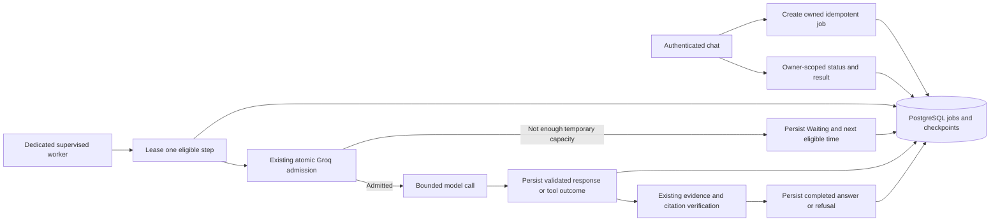

# Durable quota-aware answer jobs: feasibility and smallest migration

Date: 2 November 2026. **Design only — not implemented.**

## Decision and preserved baseline

Apply the requested stop condition. Safe process-restart resume is not a small wrapper around the existing synchronous agent. Do not ship an unawaited route promise, retry the whole question, persist only a question, or label the current quota ledger an execution checkpoint.

Inspected local `main` / HEAD `e3c99d2d99500f0e6dcf8640898e268ac6880e45` and the cached `origin/main`, which point to the same commit. The remote was not fetched, and its current state was not independently verified. The baseline is the committed final application; its success claims remain scoped to existing reports. Uncommitted numeric quota diagnostics, optional local-provider work and prior review artifacts were preserved. No rollback, model change or application modification is part of this review.

## Confirmed blockers

| Current code | Why a worker wrapper cannot resume it |
|---|---|
| `src/lib/knowledge-agent.ts` | One multi-step SDK `generateText()` call owns planning. `onStepFinish` updates closure state; it does not save a durable continuation. A thrown admission error unwinds the call. |
| `src/lib/agent-tools.ts` | Documents, CSV sources, inspected schemas, request cache, tool count and policy evaluation/provenance are private closure state. The cache contains Promises. No validated snapshot/restore contract exists. |
| `src/lib/chat-handler.ts`, `src/lib/gemini.ts` | RAG retrieval, exact quote choices, generation and verification are coupled to the HTTP request. Quota failure does not persist a pending generation. |
| `src/lib/agent-budget.ts`, `src/lib/reliability.ts`, `app/api/agent/route.ts` | Independent request/agent/planning deadlines and abort signals expire around 60/45 seconds. A durable worker cannot reuse expired signals or request-local identity. |
| `src/lib/provider-transport.ts` | Each call is capped at 30 seconds with 10 seconds reserved for execution. Changing only the outer HTTP timeout does not permit a 49–57 second admission wait. |
| `src/lib/groq-quota-store.ts` | Persists reservations, usage and cooldowns, not question state, messages, validated tools or sources. Never reset or repurpose this ledger. |
| `migrations/006-generic-csv.sql` | Stable dataset IDs survive replacement; there is no revision column. A paused answer cannot assume the dataset is unchanged. |
| `migrations/009-authentication.sql`, `src/lib/identity.ts` | Identity is bound to a verified server session and process-local scope. A worker needs a revocable internal authorization binding, not a client user ID or copied cookie. |
| `app/components/ai-chat.tsx` | Tracks an awaited request and in-page turns. No durable job creation, polling, cancellation or account-bound resume exists. |

SDK documentation in the installed package describes response-message history and step callbacks. These are useful building blocks, not a persisted, validated restoration of this application's evidence state, policy certificates, counters and cancellation lifecycle. Serializing only SDK messages would miss those protections.

## Smallest viable architecture

Keep `/api/chat` and `/api/agent` synchronous and compatible. Add a separate opt-in job path, leaving it disabled until acceptance succeeds. Reuse existing question validation, tools, retrieval, quote generation and final verification; extract their scheduling into a serializable step runner rather than replacing the reasoning logic.

A separately started worker process owns execution, not Next route lifetime. It claims work with PostgreSQL row locking (`FOR UPDATE SKIP LOCKED`), short transactions, expiring leases and fencing generations. Do not hold a database transaction or quota reservation while waiting for capacity. Worker and Next must share the existing private same-host Groq ledger and pacing configuration; this does not create global cross-host quota coordination.

### Proposed additive schema — do not apply during this review

1. `answer_jobs`: UUID, authenticated owner FK, mode, idempotency key, question payload, pinned provider/model, lifecycle status, current phase, checkpoint version, eligible time, expiry, lease/fencing state, bounded counters, safe error code and verified final result. Unique `(owner_id, idempotency_key)` prevents duplicate submissions without treating all repeated questions as duplicates. Owner/status/eligible/expiry indexes support polling and claims.
2. `answer_job_steps`: job FK, unique step sequence/key, state, bounded validated model/tool payload or receipt, evidence source/version references and dispatch certainty. Persist completed outcomes once. A unique key plus lease fencing prevents two workers committing the same step. Never store Authorization headers, API keys, passwords, cookies or raw session tokens.
3. A noncredential internal session UUID on `auth_sessions` can bind a job to its verified initiating session. Retain existing token verification unchanged. Session deletion/revocation must cancel or make the job undeliverable; expiry must be checked by the worker and poll route. This needs a reviewed additive migration and logout/cleanup integration, not token copying into jobs.
4. A monotonically increasing dataset revision, incremented inside the existing replacement transaction, provides reliable source-change detection. Existing data and IDs remain intact. Document version/status and active-policy catalog fingerprints also need revalidation. If source state changes, fail with `SOURCE_CHANGED`; do not silently combine old policy evidence with new CSV rows.

These migrations add state; they do not reset data. No SQL migration or database operation was performed in this task. Explicit schema review and isolated empty/fixture-database verification must precede any application to a working database.

Question text, saved model conversation, evidence excerpts and final answers can be sensitive even without credentials. Persist only what the pending step and strict verification require, in bounded versioned payloads with appropriate encryption/access controls and short retention. Do not reconstruct historical evidence by trusting browser input. For derived policy counts preserve the original source relationships and derivation certificate; aggregate numbers alone are insufficient. Snapshots must never expose serialized Promises, functions, abort signals or server configuration secrets.

### Proposed execution boundaries

Use explicit states: preparation → pending planning call → validate tools → execute validated read-only tools → check completion/applicability → pending final generation → citation verification → terminal outcome. Preserve the existing eight-planning-step and ten-tool limits, duplicate-work guards and strict refusals across restart, rather than resetting counters.

For RAG, persist selected owned evidence and quote choices before generation. For the Agent, persist SDK conversation messages together with source-ID allocation, inspected schemas, canonical completed-tool receipts, evidence text/metadata, completion state and policy provenance. Recreate only runtime services and abort signals after validating the checkpoint schema. This requires an explicit snapshot/restore API for `createAgentSession` and a one-step planner interface; it is the central nontrivial refactor.

On guaranteed-unsent local TPM/RPM rejection, persist the *same pending model step*, mark Waiting, and schedule its next eligible time from admission diagnostics. Release the lease. Later claimants atomically recheck real quota: stored eligible time is not a reservation or a promise of capacity. Do not rerun retrieval, earlier model calls or completed tools. Keep provider headers, cooldowns and all four real budgets authoritative. Daily exhaustion or impossible request size must fail clearly when recovery cannot fit job expiry.

When resumed, rebuild server identity from the job's verified ownership/session binding, recheck session expiry/revocation and source access/current versions, and create a worker execution context using the job deadline. Preserve the synchronous request deadline separately. Each native call stays bounded; a worker persists Waiting instead of keeping an expired HTTP request alive. No provider/model fallback is introduced.

### Dispatch uncertainty: mandatory limitation

PostgreSQL checkpoints, the file quota ledger and Groq HTTP execution cannot be committed in one atomic transaction. A process can crash after Groq executes but before its response is saved. No verified provider idempotency guarantee exists in the inspected integration.

Before dispatch, persist a dispatch-intent marker. After a successful response, persist the validated result before executing later tools. If restart finds an outcome that may have been dispatched but was not recorded, mark Failed with an explicit execution-uncertain reason; **do not automatically repeat that paid call**. Preserve conservative quota charges for unknown usage. Only a known-unsent admission rejection may be safely resumed automatically. This does not promise exactly-once provider execution or that every interrupted job can complete.

All existing AI tools are read-only; nevertheless persist their completed receipts and use stable step keys to avoid repeated logical tool execution. A crash between reading a tool result and checkpointing can leave the result uncertain. Either fail that step conservatively or perform a documented repeatable read after source-version checks; never claim universal exactly-once tool execution. Read-only SQL is not a substitute for correct checkpoint provenance.

### Proposed bounds and UI contract

Initial values for a separately reviewed implementation: ten-minute job deadline, existing eight planning steps/ten tools, ten maximum native HTTP attempts, at most 24 admission deferrals, one worker execution lane initially and at most two active jobs per user. These are design proposals, not measured or configured limits. Keep existing provider retry policy bounded within both step and job budgets; do not retry malformed output, unsupported citations or uncertain provider outcomes blindly.

Proposed new routes (not implemented): authenticated/CSRF-protected `POST /api/answer-jobs`, owner-scoped `GET /api/answer-jobs/{id}`, and authenticated/CSRF-protected cancellation. Return 202/job ID for creation, never a fabricated answer. Use safe 404 for foreign IDs. Polling exposes only safe status, retry guidance and the final verified answer, not internal checkpoints. Revalidate source authorization at delivery, including already completed jobs, to avoid serving a stored answer after source revocation/deletion.

Frontend statuses: Processing, Waiting (with safe next-check guidance), Completed (including grounded=false refusal), Failed, and Cancelled/Expired where applicable. Poll with bounded backoff; cancel/abort polling and clear private state on account change. Browser disconnect is not implicit cancellation of a durable job. Worker must notice persisted cancellation promptly; a provider call already sent cannot be retroactively unbilled. Purge private checkpoints/results on expiry with a supervised cleanup mechanism. No persistent conversation feature is implied.

## Minimal implementation sequence and risks

1. Extract explicit session snapshot/restore and one-step execution. Compare it against existing synchronous scripted-provider results before adding persistence. Do not create a second divergent agent.
2. Add reviewed tables/revisions and durable worker lease/fencing, cancellation and uncertainty handling on an isolated database.
3. Route pending calls through existing quota admission with persist-and-defer behavior. Keep all native attempt counts and unknown charges correct across crashes.
4. Add owned job APIs and opt-in UI polling, while synchronous routes remain unchanged.
5. Enable only after offline and isolated database acceptance proves parity and restart behavior. Deployment needs a continuously supervised worker and private shared storage; a Next-only serverless deployment is insufficient.

Principal regressions to prevent: changing quote/source IDs on resume; trusting stale ownership/schema; losing global policy restrictions or derived provenance; resetting call limits; executing paid calls twice after crash; issuing duplicate jobs; leaking cross-user job statuses; holding a ledger lock/reservation during a long wait; and changing current synchronous error/response behavior.

## Required acceptance proof — not yet executed

- Fake-clock RAG generation crosses a TPM window without repeating retrieval.
- CSV and combined questions cross multiple windows without repeating saved calls/tools; citations, arithmetic and refusals match existing synchronous fixtures.
- Restart after every committed boundary resumes the next step with stable source IDs and counters.
- Crash after dispatch/before checkpoint fails explicitly as uncertain without automatic paid retry.
- Two workers, lease loss, duplicate idempotency keys and concurrent cancellation do not duplicate committed work.
- Expired/revoked sessions, foreign jobs, deleted/replaced sources and new conflicting policies are rejected safely.
- TPM/provider-header/RPM/TPD/RPD, deadlines, abandoned reservations and maximum attempts remain enforced.
- Existing synchronous and provider regressions, isolated database tests, TypeScript, ESLint, build and secret/retention checks pass.

No async acceptance success, restart durability or completion-rate improvement is claimed. Existing test results only validate the pre-existing workflow. A live test is premature until the durable implementation and the above offline proof exist.

## Validation performed in this feasibility review

Ran the existing offline quota-admission, evidence-preparation and policy-applicability suites: **21 passed, zero failed, one opt-in database test skipped (22 total)**. They use fake clocks/scripted services and confirm existing guards; they do not prove durable job behavior. `git diff --check` passed. No application source changed in this review, so TypeScript, ESLint and production build were not unnecessarily repeated; their prior successful results are not presented as new async-job validation. No database-enabled writes were performed. Only this design document was created; all earlier uncommitted work remains intact. No files were staged, committed or pushed.
